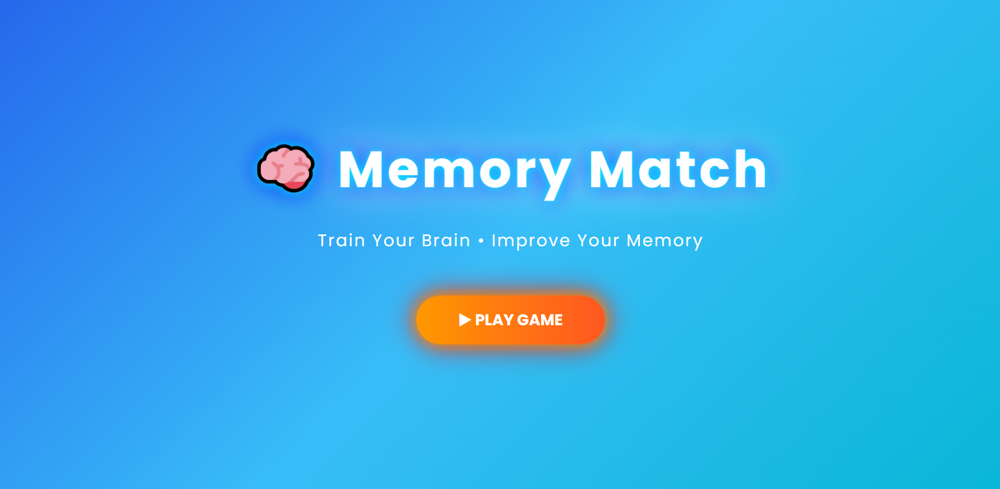
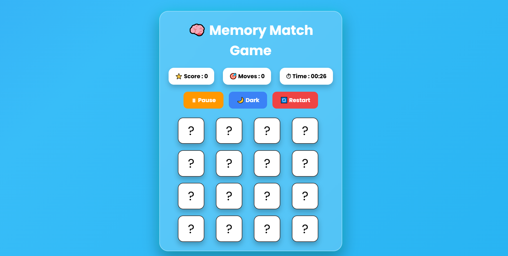
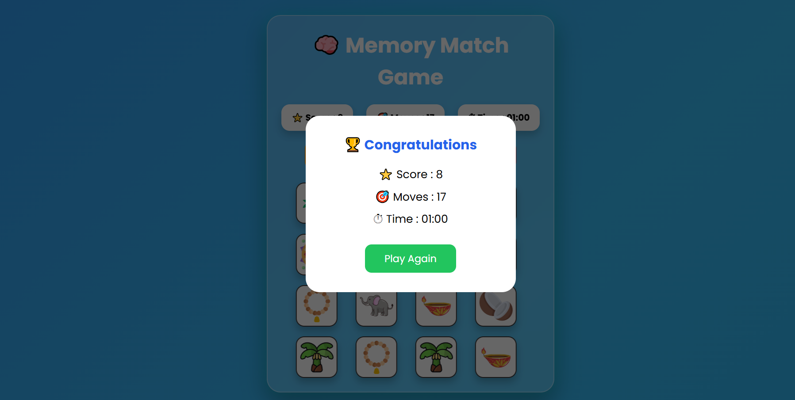

# 🧠 Memory Match Game

An interactive Memory Match Game built using **HTML5, CSS3, and JavaScript**. Test your memory by finding matching pairs of cards in the shortest time and with fewer moves!

## 🎮 Features

- **Start Screen:** Start the game with a play button.
- **Card Matching:** Flip cards and find matching image pairs.
- **Score Tracking:** Earn points for every successful match.
- **Move Counter:** Track the number of moves made.
- **Timer:** Monitor the time taken to complete the game.
- **Pause & Resume:** Pause and continue your game anytime.
- **Restart Game:** Start a new game with shuffled cards.
- **Dark Mode:** Switch between light and dark themes.
- **Sound Effects:** Audio feedback for correct matches, incorrect matches, and winning.
- **Win Popup:** View your final score, moves, and completion time.

## 🛠️ Technologies Used

- HTML5
- CSS3
- JavaScript
- PNG Images
- MP3 Audio

## 📁 Project Structure

```text
Memory-Match-Game/
│
├── images/
│   ├── elephant.png
│   ├── peacock.png
│   ├── bananatree.png
│   ├── coconut.png
│   ├── rudraksha.png
│   ├── hibiscus.png
│   ├── diya.png
│   └── rangoli.png
│
├── sounds/
│   ├── bg.mp3
│   ├── flip.mp3
│   ├── match.mp3
│   ├── wrong.mp3
│   └── win.mp3
│
├── index.html
├── style.css
└── script.js
```
## 📸 Project Screenshots

### 🏠 Home Screen


### 🎮 Gameplay


### 🏆 Winning Screen

## 🚀 How to Run the Project

1. Clone this repository:

   ```bash
   git clone https://github.com/PujalaPurnaChandrika/Memory-Match-Game.git
   ```

2. Open the project folder.

3. Open `index.html` in your web browser.

4. Click the **PLAY GAME** button and enjoy!

## 🎯 How to Play

1. Click the Play Game button.
2. Wait for the countdown.
3. Flip two cards at a time.
4. Find all 8 matching pairs.
5. Complete the game with the highest score and fewer moves!

## 👩‍💻 Developed By

**Pujala Purna Chandrika**

GitHub: [PujalaPurnaChandrika](https://github.com/PujalaPurnaChandrika)

---

⭐ If you like this project, consider giving it a star!
